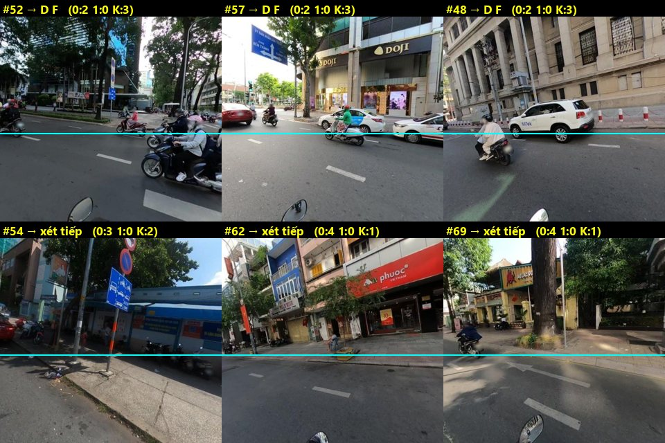
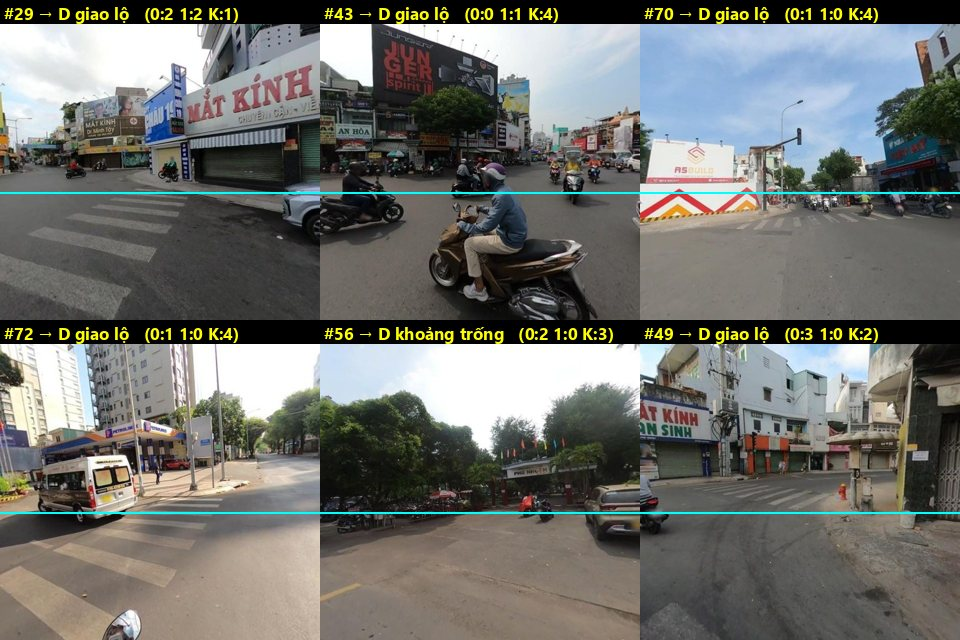
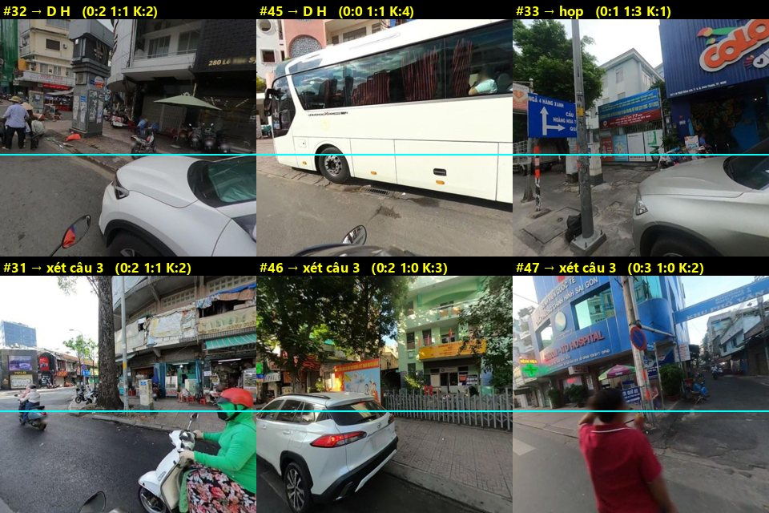
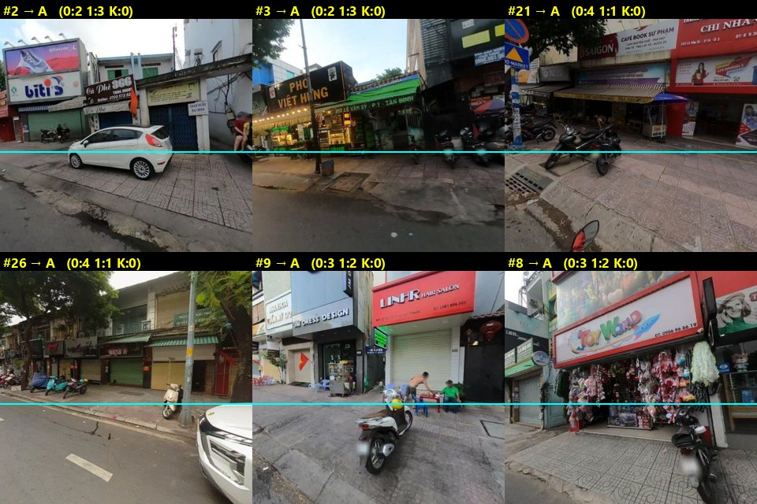
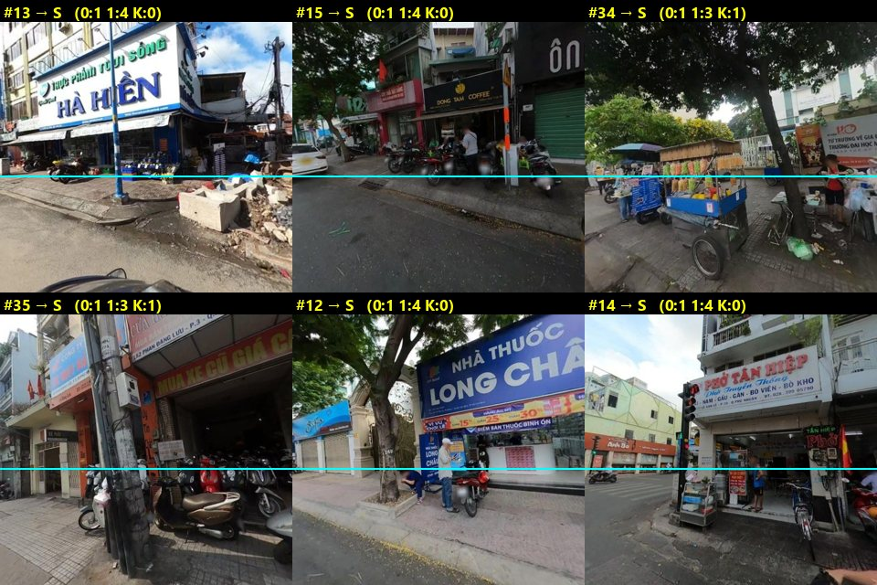
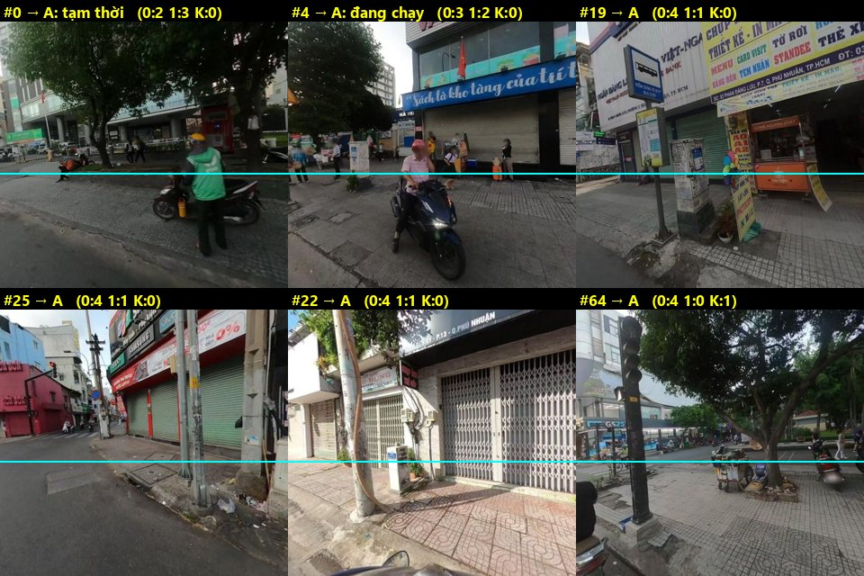
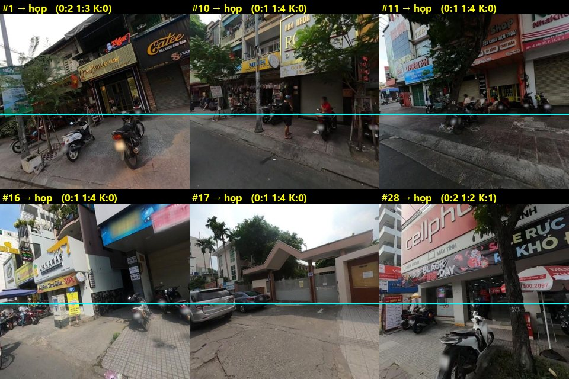

# Rà soát pilot trước buổi họp thống nhất

Nhóm sẽ họp để thống nhất cách gán rồi mới gán chính thức. Tài liệu này ghi lại số liệu pilot, chỉ ra nhóm đang lệch ở đâu, và đề xuất cách gán cho từng loại ảnh.

- Số liệu pilot giữ nguyên, không sửa nhãn của ai.
- Các nhãn đề xuất trong tài liệu là góc nhìn của Claude để cả nhóm thảo luận. **Nhãn cuối do nhóm quyết.**
- Số `#n` khớp với cột `idx` trong [pilot_review_items.csv](../data/labels/pilot_report/pilot_review_items.csv).

## 1. Số liệu pilot

5 người, 150 ảnh, gán độc lập.

| Chỉ số | Kết quả |
|---|---|
| Đồng thuận 3 lựa chọn (Fleiss κ) | **0,57**, chưa đạt ngưỡng 0,6 |
| Đồng thuận "ảnh đủ thông tin không" | 0,65 |
| Đồng thuận "còn lối đi hay bị chặn" (82 ảnh cả 5 người coi là đủ thông tin) | **0,49** |
| 5/5 đồng ý · 4/5 đồng ý · từ 3/5 trở xuống | 77 · 38 · 35 |
| Nhãn theo đa số | Còn lối đi 82 · Không đủ thông tin 44 · Bị chặn 19 · không có đa số 5 |

## 2. Nhóm đang lệch ở đâu

### Theo người

Lệch ở đây là **so với 4 người còn lại**, không có nghĩa ai đúng ai sai.

| Người | Chấm "Bị chặn" | Xu hướng | Ngưỡng "đủ thông tin" ngầm |
|---|---|---|---|
| Loan | 8% | Nới nhất: 14/21 ảnh 4 người kia chấm "Bị chặn" thì chấm "Còn lối đi"; 10/45 ảnh họ chấm "Không đủ" cũng chấm "Còn lối đi" | 0,61 |
| Khải | 12% | Khoảng giữa | 0,62 |
| Học | 15% | Khoảng giữa | 0,68 |
| Phúc | 16% | Khoảng giữa, sát nhóm nhất (89%) | 0,64 |
| Minh | 25% | Chặt nhất: trong 84 ảnh 4 người kia chấm "Còn lối đi", có 15 ảnh chấm "Bị chặn" và 12 ảnh chấm "Không đủ" | 0,72 |

Hai điểm khác cần thống nhất:
- **Tick vật cản:** Minh và Phúc chỉ tick ở ảnh "Bị chặn" (0% ở ảnh "Còn lối đi"), còn Học 21%, Khải 42%, Loan 54%. Khải còn tick ở 34% ảnh "Không đủ thông tin".
- **Cờ "Khó" gần như không ai bấm** (tối đa 1%), và không có ghi chú nào.

### Theo tình huống

73 ảnh không đồng thuận được xếp thành 8 nhóm. Cột cuối là mức κ **tối đa** nếu cả nhóm hoàn toàn thống nhất riêng nhóm đó, xuất phát từ 0,57.

| Nhóm tình huống | Số ảnh | κ tối đa nếu chốt xong |
|---|---|---|
| Vỉa hè ở xa, ảnh chủ yếu là lòng đường | 18 | 0,67 |
| Xe hoặc hàng lấn một phần vỉa hè | 18 | 0,67 |
| Xe, người che ở sát camera | 8 | 0,63 |
| Giao lộ, góc đường, khoảng trống | 10 | 0,63 |
| Ảnh thông thoáng nhưng có người chấm khác | 11 | 0,62 |
| Bị chặn rõ nhưng có người chấm khác | 4 | 0,60 |
| Xe, người dừng tạm | 2 | 0,58 |
| Ảnh cháy sáng | 2 | 0,58 |

**Hai nhóm đầu là ưu tiên của buổi họp:** chỉ riêng chúng đã có thể đưa κ lên tối đa khoảng 0,77.

## 3. Đề xuất cách gán

Trả lời lần lượt 3 câu, gặp đáp án là dừng.

**Câu 1. Ảnh có xem được không?** Cháy sáng hoặc mờ tới mức không nhận ra mặt vỉa hè thì bấm **D, G**.

**Câu 2. Có thấy vỉa hè gần không?** Tưởng tượng một vạch ngang ở **3/5 chiều cao ảnh tính từ trên xuống**.
- Mép vỉa hè giáp lòng đường (bó vỉa) không xuống tới dưới vạch thì bấm **D, F**.
- Chỉ thấy vạch qua đường hoặc góc giao lộ, không có đoạn vỉa hè chạy dọc thì bấm **D** và chọn lý do giao lộ.
- Phía này không có vỉa hè thì bấm **D, J**.
- Xe hoặc người sát camera che quá nửa đoạn vỉa hè gần thì bấm **D, H**. Che ít hơn thì chấm theo phần còn thấy.

**Câu 3. Có còn lối đi liên tục không?** Lần theo một đường đi dọc vỉa hè.
- Một người đi thẳng qua được, không phải nghiêng người, lách, hay bước xuống lòng đường thì bấm **A**.
- Có một chỗ không qua được thì bấm **S** và chọn vật cản.

**Quan trọng nhất: hỏi "còn đi được không", đừng hỏi "có nhiều xe không".** Ảnh #21 và #26 có nhiều xe nhưng vẫn còn lối đi. Ảnh #13 ít vật cản nhưng bị chắn hẳn.

### Theo từng loại ảnh

| Loại ảnh | Gán | Ví dụ |
|---|---|---|
| Chủ yếu lòng đường, vỉa hè là dải mỏng phía trên vạch | D, F | #48, #52, #57 |
| Bó vỉa xuống dưới vạch, dù vỉa hè không chiếm nhiều ảnh | Xét câu 3 | #54, #62, #69 |
| Giao lộ, vạch qua đường, sân rộng trước chợ hoặc cây xăng | D, lý do giao lộ | #29, #43, #70, #72 |
| Xe buýt, ô tô che hết đoạn gần | D, H | #32, #45 |
| Xe chạy ngang che một phần, vỉa hè vẫn thấy | Xét câu 3 | #31, #46, #47 |
| Ảnh cháy sáng | D, G | #60, #63 |
| Xe hoặc ô tô đậu sát mặt tiền, vẫn chừa dải sát mép đường | A | #2, #3, #21, #26 |
| Hàng bày sát cửa hàng, mặt vỉa hè trước đó còn trống | A | #6, #8 |
| Người đang dắt hoặc chạy xe trên vỉa hè | A (tạm thời, không tính) | #0, #4 |
| Cột điện, cây, tủ điện, còn chỗ đi | A | #19, #22, #25, #64 |
| Hàng xe kín bề ngang vỉa hè | S | #15, #35 |
| Gạch đá, xe đẩy, quầy hàng chắn lối | S | #13, #34 |
| Vỉa hè phủ kín xe hoặc hàng, không thấy mặt vỉa hè | S, không chọn D | Vỉa hè bị che bởi chính vật cản |

## 4. Cần nhóm quyết trong buổi họp

| # | Câu hỏi | Đề xuất | Căn cứ |
|---|---|---|---|
| 1 | Mốc "thấy vỉa hè gần" | Vạch 3/5 chiều cao ảnh | **Đã đo:** khớp đa số nhóm 89% (kiểm tra chéo 86%) |
| 2 | Vật cản ở xa có tính không? | Chỉ tính phần còn nhận ra từng chiếc xe, khoảng tới giữa ảnh | Quy ước, dữ liệu không phân biệt được |
| 3 | Lối hẹp bao nhiêu thì tính là chặn? | Một người đi thẳng không lách qua được; bề ngang xe máy (khoảng 0,7 m) chỉ để ước lượng bằng mắt | Quy ước, chưa đo được từ ảnh |
| 4 | Xe đậu rải rác có khe giữa các xe | Khe đi thẳng qua được thì A | Cần nhóm xem #1, #11 |
| 5 | Người đứng hoặc ngồi trên vỉa hè | Người không tính; bàn ghế, xe thì tính | Cần nhóm xem #10, #12 |
| 6 | Ô tô đậu trước cổng | Xét còn lối qua hay không như vật cản khác | Cần nhóm xem #17 |
| 7 | Khi nào tick vật cản? | Chỉ khi chọn S, và bắt buộc chọn ít nhất 1 | Để loại vật cản có nghĩa rõ là nguyên nhân chặn |
| 8 | Thêm lý do "Giao lộ / góc đường" | Thêm | 10 ảnh pilot rơi vào nhóm này |

Các ảnh cần nhóm tự quyết:

## 5. Mức độ tin cậy của các đề xuất

- **Đã đo được:** mốc 3/5 chiều cao ảnh, xu hướng lệch của từng người, thứ tự ưu tiên các nhóm tình huống.
- **Chưa kiểm chứng được:** khoảng cách xét và độ rộng lối đi (câu 2, 3). Công cụ đo trên ảnh không dự đoán được phiếu của nhóm, nên đây là quy ước nhóm tự chọn, cần được đo lại ở vòng kiểm tra.
- **Giới hạn:** pilot có 150 ảnh và chỉ 19 ảnh "Bị chặn" theo đa số. Mô hình phân đoạn ảnh cũng có sai số. Đồng thuận cao chỉ cho thấy nhóm gán nhất quán, không chứng minh nhãn đúng. Mức κ ở mục 2 là trần lý thuyết, không phải kết quả dự kiến.

## 6. Sau buổi họp

1. Chốt các câu ở mục 4, ghi vào guide v1, chọn ảnh mẫu.
2. Phân xử 35 ảnh pilot có từ 3/5 phiếu trở xuống.
3. Cập nhật giao diện gán nhãn.
4. Cả nhóm gán vòng kiểm tra 50 ảnh mới. Đạt κ ≥ 0,6 thì bắt đầu gán `MAIN`.
